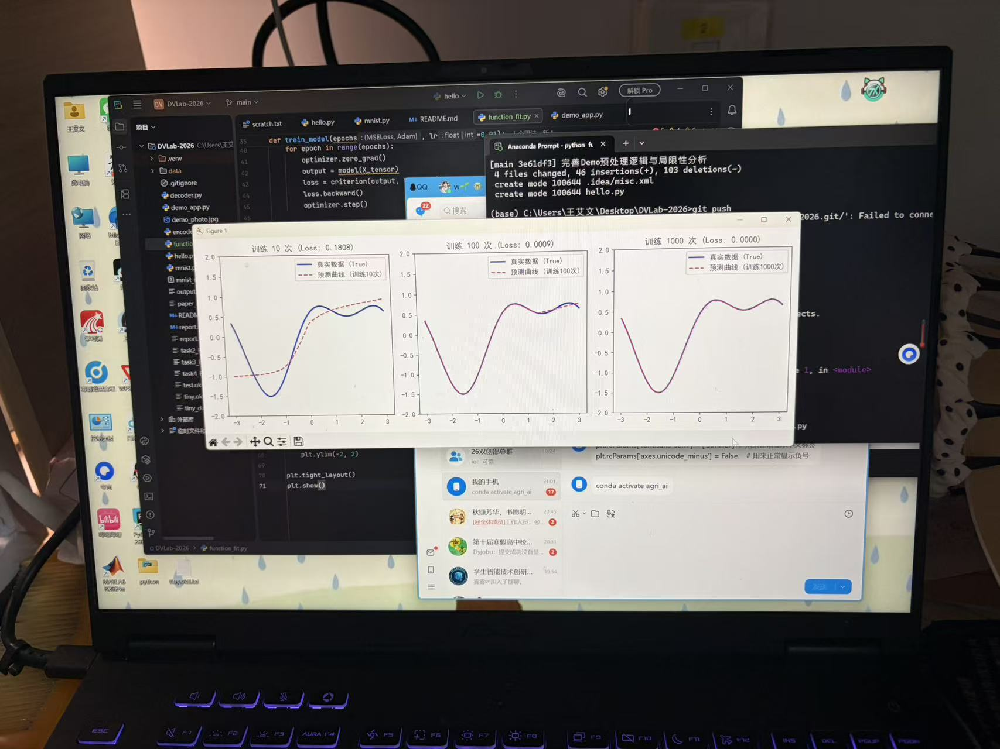

# 深度视觉农业实验室 2026 秋招前期考核

## 👨‍💻 作者信息
- **姓名**：王艾文
- **年级**：26级

## 🚀 如何运行 Demo
**1. 训练模型（CNN增强版）：**
```bash
python mnist.py
## 📈 补充研究：函数拟合与过拟合观察
为了深入理解神经网络的学习过程，我完成了补充任务 A（函数拟合）。
通过观察训练 10 次、100 次、1000 次后的曲线（见下图）：
- **训练 10 次**（Loss: 0.1808）：模型未能捕捉真实曲线规律，属于**欠拟合**。
- **训练 100 次**（Loss: 0.0009）：预测曲线与真实曲线高度重合，模型具备了良好的泛化能力。
- **训练 1000 次**（Loss: 0.0000）：Loss 极低，说明模型在训练集上拟合到了极致。
**总结思考**：通过这个实验，我直观地理解了训练轮数（Epoch）与模型欠拟合、过拟合之间的关系，在后续的 MNIST 任务中，我也运用了这些知识来选择合理的训练轮次。

